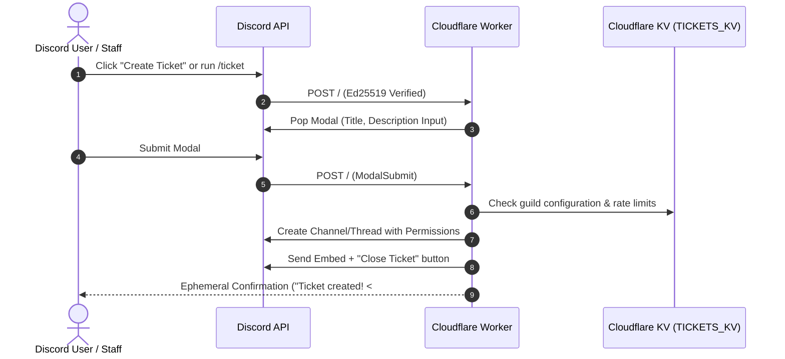

# 🎫 Serverless Discord Tickets

A modern, open-source, and fully customizable Discord support ticket system built for **Cloudflare Workers**. 

Powered 100% by Discord's **HTTP Interactions API** — meaning **zero WebSocket gateway connections**, **zero idle server costs**, instant cold starts, and seamless hosting on Cloudflare's free tier.

Includes a **built-in Web UI Dashboard** accessible directly from Discord via `/ticket-admin customize` featuring live Discord embed previews, server role/channel pickers, and real-time command syncing.

---

## 📑 Table of Contents

- [Overview](#-overview)
- [Key Features](#-key-features)
- [How It Works & Architecture](#-how-it-works--architecture)
- [Step-by-Step Setup Guide](#-step-by-step-setup-guide)
  - [1. Create & Configure Discord Application](#1-create--configure-discord-application)
  - [2. Clone & Install Dependencies](#2-clone--install-dependencies)
  - [3. Set Up Cloudflare KV](#3-set-up-cloudflare-kv)
  - [4. Set Secrets & Deploy](#4-set-secrets--deploy)
  - [5. Set Discord Interactions Endpoint](#5-set-discord-interactions-endpoint)
  - [6. Register Slash Commands](#6-register-slash-commands)
  - [7. Customize & Post Panel](#7-customize--post-panel)
- [Features & Usage Guide](#-features--usage-guide)
  - [Web UI Customization Dashboard](#web-ui-customization-dashboard-ticket-admin-customize)
  - [Ticket Modes (Channel vs. Thread)](#ticket-modes-channel-vs-thread)
  - [Slash Commands & Aliases](#slash-commands--aliases)
  - [Ticket Panels & Modal Flow](#ticket-panels--modal-flow)
  - [Ticket Lifecycle: Archive & Deletion](#ticket-lifecycle-archive--deletion)
  - [Concurrent Ticket Limits](#concurrent-ticket-limits)
  - [Multi-Language Localizations](#multi-language-localizations)
- [Configuration Layers](#-configuration-layers)
- [Local Development](#-local-development)
- [Contributing](#-contributing)
- [License](#-license)

---

## 🌟 Overview

Traditional Discord ticket bots run continuous Node.js / Python gateway processes that stay connected 24/7, consuming RAM and computing power even when nobody is opening a ticket.

**Serverless Discord Tickets** leverages Discord's HTTP webhook interactions. When a user clicks a button, submits a modal, or runs a slash command, Discord sends an HTTP POST request to your Cloudflare Worker. The worker verifies cryptographic signatures (Ed25519), processes the action in milliseconds, and sleeps.

- ⚡ **Lightning Fast**: Sub-100ms global edge response times.
- 💰 **100% Free to Host**: Comfortably fits inside Cloudflare Workers' generous free tier (100,000 requests/day).
- 🎨 **Visual Customizer**: No need to edit code to change colors, titles, emojis, or messages.
- 🔒 **Secure**: Ephemeral admin links, role-based access control, and signature verification.

---

## ✨ Key Features

- **Built-in Web UI Customizer**: Run `/ticket-admin customize` to get an ephemeral, secure 10-minute web dashboard link.
- **Live Discord Preview**: See real-time previews of panel embeds, opened ticket embeds, and closed ticket embeds as you customize colors, text, and emojis.
- **Server Introspection**: Web dashboard automatically populates dropdowns and role pills with your server's actual categories, channels, and staff roles.
- **Dual Ticket Modes**:
  - **Channel Mode**: Dedicated private text channels with automatic permission overwrites and category archival.
  - **Thread Mode**: Lightweight private threads inside a designated support channel.
- **Configurable Ticket Limits**: Restrict users to a maximum number of concurrent open tickets (default: 1) or allow unlimited.
- **Customizable Commands & Aliases**: Rename `/ticket` (e.g. to `/destek`, `/help`, `/support`), define alternative aliases, and configure native Discord localized names/descriptions for multiple languages.
- **Real-Time Command Sync**: Updating command names or aliases in the Web UI immediately synchronizes with Discord without worker redeployment.
- **Full Role & Permission Management**: Ticket owners and designated staff roles can view/manage tickets; only staff can delete archived tickets.

---

## 🏗 How It Works & Architecture



---

## 🚀 Step-by-Step Setup Guide

Follow these step-by-step instructions to deploy the bot and add it to your Discord server.

### 1. Create & Configure Discord Application

1. Go to the [Discord Developer Portal](https://discord.com/developers/applications) and click **New Application**.
2. Give your bot a name and accept the terms.
3. In **General Information**:
   - Copy the **Application ID**.
   - Copy the **Public Key**.
4. In the left menu, navigate to **Bot**:
   - Click **Reset Token** (or **Add Bot**) and copy your **Bot Token**.
5. In the left menu, navigate to **OAuth2 → URL Generator**:
   - Under **Scopes**, check:
     - `bot`
     - `applications.commands`
   - Under **Bot Permissions**, check:
     - **Manage Channels** (required for channel mode)
     - **Manage Threads** (required for thread mode)
     - **Send Messages**
     - **Send Messages in Threads**
     - **Embed Links**
     - **Read Message History**
     - **Attach Files**
     - **Use External Emojis**
   - Copy the generated URL at the bottom, paste it into your browser, and invite the bot to your server.

---

### 2. Clone & Install Dependencies

Clone the repository and install the project dependencies:

```bash
git clone https://github.com/your-username/serverless-discord-tickets.git
cd serverless-discord-tickets
npm install
```

---

### 3. Set Up Cloudflare KV

The Web UI dashboard and per-server configurations require a Cloudflare KV namespace.

1. Log in to Wrangler with your Cloudflare account (if not already logged in):
   ```bash
   npx wrangler login
   ```
2. Create a KV namespace:
   ```bash
   npx wrangler kv:namespace create TICKETS_KV
   ```
3. Copy the output `id` and update your [wrangler.toml](file:///h:/IdeaProjects/serverless-discord-tickets/wrangler.toml):
   ```toml
   [[kv_namespaces]]
   binding = "TICKETS_KV"
   id = "PASTE_YOUR_KV_NAMESPACE_ID_HERE"
   ```

---

### 4. Set Secrets & Deploy

#### Option A: Deploy via CLI (Wrangler)

1. Set your Discord secrets on Cloudflare:
   ```bash
   npx wrangler secret put DISCORD_TOKEN
   # Paste your Bot Token when prompted

   npx wrangler secret put DISCORD_PUBLIC_KEY
   # Paste your Public Key when prompted

   npx wrangler secret put DISCORD_APPLICATION_ID
   # Paste your Application ID when prompted
   ```
2. Deploy the worker:
   ```bash
   npm run deploy
   ```
3. Wrangler will output your live Worker URL (e.g. `https://serverless-discord-tickets.your-subdomain.workers.dev`).

#### Option B: Deploy via GitHub & Cloudflare Dashboard

1. Push your repository to GitHub.
2. In the [Cloudflare Dashboard](https://dash.cloudflare.com/), go to **Workers & Pages** → **Create** → **Pages / Workers** → **Connect to Git**.
3. Set the build/deploy command to:
   ```bash
   npx wrangler deploy --keep-vars
   ```
4. Once deployed, go to your Worker's **Settings → Variables and Secrets → Secrets** and add:
   - `DISCORD_TOKEN`
   - `DISCORD_PUBLIC_KEY`
   - `DISCORD_APPLICATION_ID`

---

### 5. Set Discord Interactions Endpoint

1. Go back to the [Discord Developer Portal](https://discord.com/developers/applications).
2. Select your application → **General Information**.
3. Under **Interactions Endpoint URL**, paste your Cloudflare Worker URL:
   ```
   https://serverless-discord-tickets.your-subdomain.workers.dev
   ```
4. Click **Save Changes**.
   > [!NOTE]
   > Discord will immediately send a `PING` payload to verify the endpoint. The worker responds with `PONG` automatically using cryptographic signature verification.

---

### 6. Register Slash Commands

Register the slash commands for your Discord server.

1. Create a `.dev.vars` file for local scripting:
   ```bash
   cp .dev.vars.example .dev.vars
   ```
2. Fill in `DISCORD_TOKEN` and `DISCORD_APPLICATION_ID` in `.dev.vars`.
3. Register the commands to your specific server (instant):
   ```bash
   npm run register-command -- YOUR_GUILD_ID
   ```
   *(To find your Guild ID: Enable Developer Mode in Discord Settings → Right-click your server icon → **Copy Server ID**)*

---

### 7. Customize & Post Panel

1. **Customize Settings**:
   - In any channel on your Discord server, type:
     ```
     /ticket-admin customize
     ```
     *(Requires Administrator or Manage Server permissions).*
   - Click the **Open Customization Web UI** button.
   - Configure your ticket mode, categories, staff roles, embed styles, and command aliases.
   - Click **Save Changes**.

2. **Post the Ticket Panel**:
   - In your desired support channel (e.g., `#create-a-ticket`), run:
     ```
     /ticket-admin panel
     ```
   - The bot will post the ticket creation embed panel with the interactive button.

---

## 🛠 Features & Usage Guide

### Web UI Customization Dashboard (`/ticket-admin customize`)

The Web UI dashboard allows server administrators to configure every aspect of the ticket system without touching code or redeploying.

- **How to access**: Run `/ticket-admin customize` in your server. The bot returns an ephemeral message with a secure link valid for 10 minutes.
- **What you can customize**:
  - **Structure**: Ticket Mode (Channel or Thread), Active Category, Archive Category, Support Thread Channel, Staff Roles, and Max Open Tickets Per User.
  - **Commands & Aliases**: Custom primary command name, alternative aliases (e.g., `destek`, `talep`, `support`), and Discord name/description localizations.
  - **Embeds & Appearance**: Live preview of the Panel, Ticket Opened, and Ticket Closed embeds. Customize titles, description templates, and colors.
  - **Buttons & Modals**: Button labels, styles (Primary, Secondary, Success, Danger), emojis, modal titles, and input placeholders.
  - **Channel Naming**: Formats such as `ticket-{username}` or `ticket-{userId}`.

---

### Ticket Modes (Channel vs. Thread)

| Feature | Channel Mode (`channel`) | Thread Mode (`thread`) |
| :--- | :--- | :--- |
| **Best For** | Large servers, formal support, archiving history | Small/medium servers, clutter-free setup |
| **Location** | Dedicated category (`TICKET_CATEGORY_ID`) | Parent text channel (`THREAD_CHANNEL_ID`) |
| **Privacy** | Hidden from `@everyone`; visible only to ticket owner and staff roles | Private thread; only accessible to invited member and staff |
| **Close Action** | Moved to `ARCHIVE_CATEGORY_ID`; user access revoked | Thread archived and locked |
| **Delete Action** | Staff can permanently delete the channel via the "Delete" button | Deleted via Discord channel controls |

---

### Slash Commands & Aliases

The bot includes two main command structures:

#### 1. User Ticket Command (`/ticket`)
- **Default**: `/ticket`
- **Aliases**: Configurable in Web UI (e.g., `/destek`, `/help`, `/support`).
- **Usage**: Any server member runs `/ticket` to open a modal popup requesting a description of their issue.

#### 2. Admin Command (`/ticket-admin`)
- **Subcommands**:
  - `/ticket-admin panel` — Posts the support panel embed with the "Create Ticket" button in the current channel.
  - `/ticket-admin customize` — Generates a 10-minute secure link to the Web UI dashboard.
- **Permissions**: Restricted to server members with **Administrator** or **Manage Server** permissions.

---

### Ticket Panels & Modal Flow

1. **Panel Creation**: Run `/ticket-admin panel` in your support channel.
2. **User Interaction**: A user clicks the **Create Ticket** button (or runs `/ticket`).
3. **Modal Prompt**: Discord displays a popup asking for the issue description.
4. **Channel Creation**: The bot creates a private channel/thread, pings the configured staff roles and ticket creator, and displays the **Ticket Opened** embed.
5. **Direct Navigation**: The user receives an ephemeral link directly to their new ticket channel.

---

### Ticket Lifecycle: Archive & Deletion

1. **Closing**:
   - The ticket creator or any staff member can click the **Close Ticket** button.
   - In **Channel Mode**: The channel is moved to the **Archive Category**, and the ticket creator's view permission is revoked.
   - In **Thread Mode**: The thread is archived and locked.
2. **Deleting**:
   - A **Delete Ticket** button appears in the closed ticket embed.
   - Only users with a **Staff Role** can click Delete to permanently delete the archived channel.

---

### Concurrent Ticket Limits

Prevent ticket spam by configuring `MAX_OPEN_TICKETS_PER_USER`:
- Set to `1` (default) to allow only 1 open ticket per user at a time.
- Set to any positive number (e.g., `3`) for custom limits.
- Set to `0` to disable limits and allow unlimited open tickets.

When a user reaches their limit, the bot blocks creation and sends an ephemeral message explaining they already have active tickets.

---

### Multi-Language Localizations

Discord natively supports slash command localizations. You can configure translated command names and descriptions for different languages (e.g., English, Turkish, German, Spanish, French):

```json
{
  "nameLocalizations": {
    "tr": "destek",
    "de": "ticket",
    "es-ES": "soporte"
  },
  "descriptionLocalizations": {
    "tr": "Destek talebi oluşturun",
    "de": "Öffnen Sie ein Support-Ticket",
    "es-ES": "Abrir un ticket de soporte"
  }
}
```

When users have their Discord client set to these languages, Discord automatically displays the localized command.

---

## ⚙️ Configuration Layers

The bot resolves its settings using a multi-layer configuration hierarchy:

```mermaid
flowchart TD
    A[1. Code Defaults<br/><code>src/config.ts</code>] --> B[2. Global / Fallback Overrides<br/><code>BOT_CONFIG_OVERRIDES</code> Secret]
    B --> C[3. Per-Guild KV Customizations<br/><code>TICKETS_KV (guild_config:ID)</code>]
    C --> D[Effective Runtime Config]
```

| Layer | Storage | Managed By | Purpose |
| :--- | :--- | :--- | :--- |
| **Code Defaults** | `src/config.ts` | Source Code | Base defaults and fallback values |
| **Global Overrides** | `BOT_CONFIG_OVERRIDES` (Secret) | Cloudflare Secrets / `.dev.vars` | Global instance defaults without editing code |
| **Guild Customizations** | Cloudflare KV (`TICKETS_KV`) | Web UI Dashboard | Server-specific settings, channels, roles, and styles |

### Encoding Config Overrides

If you want to set global overrides using `BOT_CONFIG_OVERRIDES`:

1. Copy [config.overrides.example.json](file:///h:/IdeaProjects/serverless-discord-tickets/config.overrides.example.json) to `config.overrides.json` and adjust your values.
2. Run the encoder:
   ```bash
   npm run encode-config -- config.overrides.json
   ```
3. Copy the output string and set it in Cloudflare Secrets:
   ```bash
   npx wrangler secret put BOT_CONFIG_OVERRIDES
   ```

---

## 💻 Local Development

### 1. Environment Setup

Copy `.dev.vars.example` to `.dev.vars` and configure your test credentials:

```ini
DISCORD_TOKEN=your_bot_token
DISCORD_PUBLIC_KEY=your_public_key
DISCORD_APPLICATION_ID=your_application_id

TICKET_MODE=channel
TICKET_CATEGORY_ID=your_ticket_category_id
ARCHIVE_CATEGORY_ID=your_archive_category_id
STAFF_ROLE_IDS=your_staff_role_id
```

### 2. Run Local Worker

Start the local Wrangler development server:

```bash
npm run dev
```

### 3. Expose Local Worker to Discord

Because Discord interactions require a public HTTPS URL:
1. Use a tunneling tool such as [Cloudflare Tunnel](https://developers.cloudflare.com/cloudflare-one/connections/connect-networks/) or [ngrok](https://ngrok.com/):
   ```bash
   ngrok http 8787
   ```
2. Paste the HTTPS forwarding URL into your **Discord Developer Portal → Interactions Endpoint URL**.

### 4. Type Checking

Validate TypeScript types across the project:

```bash
npm run typecheck
```

---

## 📁 Project Structure

```
serverless-discord-tickets/
├── scripts/
│   ├── encode-config-overrides.ts  # CLI tool to stringify JSON overrides
│   ├── load-dev-vars.ts            # Local development env helper
│   └── register-command.ts         # Script to register Discord slash commands
├── src/
│   ├── discord/
│   │   ├── api.ts                  # Discord REST API client & error handling
│   │   └── components.ts           # Discord embeds, buttons, and modal builders
│   ├── handlers/
│   │   ├── close-button.ts         # Handles ticket closing & archiving
│   │   ├── command.ts              # Handles /ticket and /ticket-admin panel commands
│   │   ├── create-button.ts        # Handles "Create Ticket" button clicks
│   │   ├── create-modal.ts         # Handles modal submission & channel creation
│   │   ├── customize-command.ts    # Generates secure Web UI session tokens
│   │   └── delete-button.ts        # Handles ticket deletion from archive
│   ├── web/
│   │   ├── html.ts                 # Web UI single-page application & preview renderer
│   │   └── router.ts               # Web UI routes & REST API endpoints
│   ├── config.ts                   # Bot configuration schemas, defaults, & mergers
│   ├── env.ts                      # Environment bindings & permission bitmasks
│   ├── index.ts                    # Worker entrypoint & interaction routing
│   ├── responses.ts                # Interaction response helpers
│   ├── types.ts                    # Discord API & interaction TypeScript types
│   └── verify.ts                   # Ed25519 request signature verification
├── config.overrides.example.json   # Example JSON overrides template
├── wrangler.toml                   # Cloudflare Workers configuration
└── package.json
```

---

## 🤝 Contributing

Contributions, issues, and feature requests are welcome!

1. **Fork the Repository**
2. **Create a Feature Branch**:
   ```bash
   git checkout -b feature/amazing-feature
   ```
3. **Commit Your Changes**:
   ```bash
   git commit -m "Add amazing new feature"
   ```
4. **Check Types & Linting**:
   ```bash
   npm run typecheck
   ```
5. **Push to the Branch**:
   ```bash
   git push origin feature/amazing-feature
   ```
6. **Open a Pull Request**

Please make sure your code adheres to TypeScript standards and includes appropriate error handling.

---

## 📜 License

This project is licensed under the [MIT License](file:///h:/IdeaProjects/serverless-discord-tickets/LICENSE).
