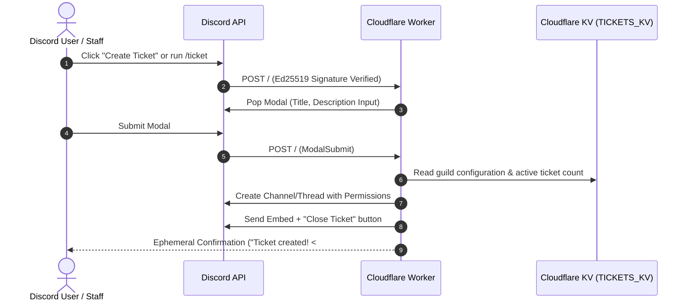

# Serverless Discord Tickets

A modern, open-source, and fully customizable Discord support ticket system built for **Cloudflare Workers**. 

Powered 100% by Discord's **HTTP Interactions API** — meaning **zero WebSocket gateway connections**, **zero idle server costs**, instant cold starts, and seamless hosting on Cloudflare's free tier.

Includes a **built-in Web UI Dashboard** accessible directly from Discord via `/ticket-admin customize` featuring live Discord embed previews, server role/channel pickers, and real-time command syncing.

[](https://deploy.workers.cloudflare.com/?url=https://github.com/UsainSrht/serverless-discord-tickets)

---

## Table of Contents

- [Overview](#overview)
- [Key Features](#key-features)
- [Architecture & How It Works](#architecture--how-it-works)
- [Step-by-Step Setup Guide (No Code / Dashboard Only)](#step-by-step-setup-guide-no-code--dashboard-only)
  - [1. Create & Configure Discord Application](#1-create--configure-discord-application)
  - [2. Deploy to Cloudflare Workers](#2-deploy-to-cloudflare-workers)
  - [3. Configure KV Storage & Secrets in Cloudflare](#3-configure-kv-storage--secrets-in-cloudflare)
  - [4. Set Discord Interactions Endpoint](#4-set-discord-interactions-endpoint)
  - [5. Register Slash Commands](#5-register-slash-commands)
  - [6. Customize Settings & Post Ticket Panel](#6-customize-settings--post-ticket-panel)
  - [7. Receiving Automatic Updates](#7-receiving-automatic-updates)
- [Features & Usage Guide](#features--usage-guide)
  - [Web UI Customization Dashboard](#web-ui-customization-dashboard)
  - [Ticket Modes (Channel vs. Thread)](#ticket-modes-channel-vs-thread)
  - [Slash Commands & Aliases](#slash-commands--aliases)
  - [Ticket Panels & Modal Flow](#ticket-panels--modal-flow)
  - [Ticket Lifecycle: Archive & Deletion](#ticket-lifecycle-archive--deletion)
  - [Concurrent Ticket Limits](#concurrent-ticket-limits)
  - [Multi-Language Localizations](#multi-language-localizations)
- [Local Development (For Developers)](#local-development-for-developers)
- [Contributing](#contributing)
- [License](#license)

---

## Overview

Traditional Discord ticket bots run continuous Node.js or Python gateway processes that stay connected 24/7, consuming server memory and CPU even when nobody is opening a ticket.

**Serverless Discord Tickets** leverages Discord's HTTP webhook interactions. When a user clicks a button, submits a modal, or runs a slash command, Discord sends an HTTP POST request to your Cloudflare Worker. The worker verifies cryptographic signatures (Ed25519), processes the action in milliseconds, and sleeps.

- **Fast**: Global edge response times with sub-100ms execution.
- **100% Free to Host**: Runs inside Cloudflare Workers' free tier (100,000 requests/day).
- **Zero File Editing**: Fully configurable through the built-in Web UI and Cloudflare Dashboard.
- **Auto-Updating**: Connect via GitHub and receive upstream improvements with one click.
- **Secure**: Ephemeral admin authentication, signature verification, and role-based access.

---

## Key Features

- **Built-in Web UI Customizer**: Run `/ticket-admin customize` in Discord to receive a secure 10-minute web dashboard link.
- **Live Discord Preview**: Real-time visual previews of panel embeds, opened ticket embeds, and closed ticket embeds as you customize colors, text, and emojis.
- **Server Introspection**: Web dashboard automatically populates dropdowns with your server's actual categories, channels, and staff roles.
- **Dual Ticket Modes**:
  - **Channel Mode**: Dedicated private text channels with automatic permission overwrites and category archival.
  - **Thread Mode**: Lightweight private threads inside a designated support channel.
- **Configurable Ticket Limits**: Restrict users to a maximum number of concurrent open tickets (default: 1) or allow unlimited.
- **Customizable Commands & Aliases**: Rename `/ticket` (e.g. to `/destek`, `/help`, `/support`), define aliases, and configure Discord localized names for multiple languages.
- **Real-Time Command Sync**: Updating command names or aliases in the Web UI immediately synchronizes with Discord without redeploying.
- **Full Role & Permission Management**: Ticket owners and designated staff roles can view and manage tickets; only staff can delete archived tickets.

---

## Architecture & How It Works



---

## Step-by-Step Setup Guide (No Code / Dashboard Only)

You do not need to install any software, edit source code, or run terminal commands. The entire setup is performed through the Discord and Cloudflare dashboards.

### 1. Create & Configure Discord Application

1. Open the [Discord Developer Portal](https://discord.com/developers/applications) and click **New Application** (top right).
2. Enter a name for your bot, accept the terms, and click **Create**.
3. Under **General Information**:
   - Copy and save your **Application ID**.
   - Copy and save your **Public Key**.
4. In the left menu, navigate to **Bot**:
   - Click **Reset Token** (confirm with 2FA if prompted).
   - Copy and save your **Bot Token**.
5. In the left menu, navigate to **OAuth2** → **URL Generator**:
   - Under **Scopes**, select:
     - `bot`
     - `applications.commands`
   - Under **Bot Permissions**, select:
     - **Manage Channels** (required for channel mode)
     - **Manage Threads** (required for thread mode)
     - **Send Messages**
     - **Send Messages in Threads**
     - **Embed Links**
     - **Read Message History**
     - **Attach Files**
     - **Use External Emojis**
   - Copy the generated URL at the bottom of the page, open it in a new browser tab, and invite the bot to your Discord server.

---

### 2. Deploy to Cloudflare Workers

Choose **Option A** (One-Click) or **Option B** (Manual Git Connect):

#### Option A: 1-Click Deploy
Click the button below to start the automated Cloudflare deployment wizard:

[](https://deploy.workers.cloudflare.com/?url=https://github.com/UsainSrht/serverless-discord-tickets)

Cloudflare will prompt you to log in, authorize GitHub, create a fork of this repository in your account, and deploy the worker automatically.

#### Option B: Connect Existing Git Repository
1. Go to the [GitHub Repository](https://github.com/UsainSrht/serverless-discord-tickets) and click **Fork** (top right).
2. Open the [Cloudflare Dashboard](https://dash.cloudflare.com/).
3. In the sidebar, go to **Workers & Pages** → click **Create application** → **Pages / Workers** → select **Connect to Git**.
4. Select your forked `serverless-discord-tickets` repository and click **Begin setup**.
5. Leave the build settings as default and click **Save and Deploy**.

---

### 3. Configure KV Storage & Secrets in Cloudflare

#### Step 3.1: Create KV Namespace
1. In Cloudflare Dashboard, go to **Storage & Databases** → **KV** in the left sidebar.
2. Click **Create namespace**.
3. Set the namespace name to `TICKETS_KV` and click **Add**.

#### Step 3.2: Bind KV to Your Worker
1. In Cloudflare Dashboard, go to **Workers & Pages** and click on your newly deployed worker.
2. Navigate to **Settings** → **Bindings** (or **Variables and Secrets** depending on dashboard layout).
3. Under **KV Namespace Bindings**, click **Add**:
   - **Variable name**: `TICKETS_KV` *(must be exact uppercase)*
   - **KV namespace**: Select `TICKETS_KV` from the dropdown.
4. Click **Save and deploy**.

#### Step 3.3: Add Discord Secrets
1. In your Worker's **Settings** → **Variables and Secrets** (or **Environment Variables**), click **Add** under **Environment Variables / Secrets**.
2. Add the following 3 variables (select **Encrypt** for secrets):

| Variable Name | Value | Type |
| :--- | :--- | :--- |
| `DISCORD_TOKEN` | Paste your **Bot Token** (from Step 1) | Secret (Encrypted) |
| `DISCORD_PUBLIC_KEY` | Paste your **Public Key** (from Step 1) | Plain text / Secret |
| `DISCORD_APPLICATION_ID` | Paste your **Application ID** (from Step 1) | Plain text / Secret |

3. Click **Deploy** / **Save**.

---

### 4. Set Discord Interactions Endpoint

1. Go to your Worker's overview page in Cloudflare Dashboard and copy your live Worker URL (e.g. `https://serverless-discord-tickets.your-subdomain.workers.dev`).
2. Open the [Discord Developer Portal](https://discord.com/developers/applications) and select your application.
3. Under **General Information**, locate the **Interactions Endpoint URL** field.
4. Paste your Worker URL into the field and click **Save Changes**.

> [!NOTE]
> Discord sends a verification ping immediately when you save. If Discord reports an error, verify that `DISCORD_PUBLIC_KEY` is saved correctly in your Cloudflare secrets.

---

### 5. Register Slash Commands

To register the `/ticket` and `/ticket-admin` slash commands with Discord, open your browser and visit your worker's registration link:

```
https://YOUR_WORKER_URL.workers.dev/register-commands
```

You will receive a JSON response confirming that slash commands have been registered:
```json
{
  "success": true,
  "scope": "global",
  "message": "Successfully registered slash commands with Discord!",
  "commands": ["ticket", "ticket-admin"]
}
```

> [!TIP]
> Discord global commands may take a few minutes to appear in all servers. To register commands **instantly** to a specific server with zero delay, add your Server ID to the URL:
> `https://YOUR_WORKER_URL.workers.dev/register-commands?guild=YOUR_SERVER_ID`

---

### 6. Customize Settings & Post Ticket Panel

1. **Open the Web UI**:
   - Go to your Discord server and type:
     ```
     /ticket-admin customize
     ```
   - Click the **Open Customization Web UI** button in the bot's response.
2. **Configure Your Server**:
   - Select your **Ticket Category**, **Archive Category**, and **Staff Roles**.
   - Customize embed colors, titles, descriptions, and button labels.
   - Click **Save Changes** (the bot will save to `TICKETS_KV` and automatically sync slash commands).
3. **Post the Support Panel**:
   - In your support channel (e.g. `#tickets` or `#support`), type:
     ```
     /ticket-admin panel
     ```
   - The bot will post the support panel embed with the **Create Ticket** button.

---

### 7. Receiving Automatic Updates

When updates, improvements, or bug fixes are published to the main repository:

1. Open your forked repository on GitHub.
2. Click **Sync fork** → **Update branch**.
3. Cloudflare Workers will automatically detect the commit, build, and deploy the new version.
4. **All your secrets (`DISCORD_TOKEN`), configurations, and KV bindings remain untouched.**

---

## Features & Usage Guide

### Web UI Customization Dashboard

The Web UI dashboard allows administrators to configure the ticket bot visually without touching code.

- **Access**: Run `/ticket-admin customize` in any channel on your Discord server.
- **Configurable Settings**:
  - **Structure**: Ticket Mode (Channel or Thread), Active Category, Archive Category, Support Thread Channel, Staff Roles, and Concurrent Ticket Limits.
  - **Commands & Aliases**: Custom primary command name, alternative aliases (e.g., `destek`, `support`), and Discord name/description localizations.
  - **Embeds & Appearance**: Live preview of the Panel, Ticket Opened, and Ticket Closed embeds. Customize titles, description templates, and colors.
  - **Buttons & Modals**: Button labels, styles (Primary, Secondary, Success, Danger), emojis, modal titles, and input placeholders.
  - **Channel Naming**: Formats such as `ticket-{username}` or `ticket-{userId}`.

---

### Ticket Modes (Channel vs. Thread)

| Feature | Channel Mode (`channel`) | Thread Mode (`thread`) |
| :--- | :--- | :--- |
| **Best For** | Structured servers, dedicated archiving | Lightweight support, clutter-free setup |
| **Location** | Dedicated category (`TICKET_CATEGORY_ID`) | Parent text channel (`THREAD_CHANNEL_ID`) |
| **Privacy** | Hidden from `@everyone`; visible to ticket owner and staff | Private thread; accessible only to invited member and staff |
| **Close Action** | Moved to `ARCHIVE_CATEGORY_ID`; user access revoked | Thread archived and locked |
| **Delete Action** | Staff can permanently delete the channel via the "Delete" button | Managed via Discord channel controls |

---

### Slash Commands & Aliases

#### User Ticket Command (`/ticket`)
- **Default**: `/ticket`
- **Aliases**: Configurable in Web UI (e.g., `/destek`, `/help`, `/support`).
- **Usage**: Any server member runs `/ticket` to open a modal popup requesting a description of their issue.

#### Admin Command (`/ticket-admin`)
- **Subcommands**:
  - `/ticket-admin panel` — Posts the support panel embed with the "Create Ticket" button in the current channel.
  - `/ticket-admin customize` — Generates a 10-minute secure link to the Web UI dashboard.
- **Permissions**: Restricted to server members with **Administrator** or **Manage Server** permissions.

---

### Ticket Panels & Modal Flow

1. **Panel Creation**: Run `/ticket-admin panel` in your support channel.
2. **User Interaction**: A user clicks the **Create Ticket** button (or runs `/ticket`).
3. **Modal Prompt**: Discord displays a popup asking for the issue title and description.
4. **Channel Creation**: The bot creates a private channel or thread, pings the configured staff roles and ticket creator, and displays the **Ticket Opened** embed.
5. **Direct Navigation**: The user receives an ephemeral message with a direct link to their new ticket channel.

---

### Ticket Lifecycle: Archive & Deletion

1. **Closing**:
   - The ticket creator or any staff member can click the **Close Ticket** button.
   - In **Channel Mode**: The channel is moved to the **Archive Category**, and the ticket creator's view permission is revoked.
   - In **Thread Mode**: The thread is archived and locked.
2. **Deleting**:
   - A **Delete Ticket** button appears in the closed ticket embed.
   - Only users with a **Staff Role** can click Delete to permanently delete the archived channel.

---

### Concurrent Ticket Limits

Prevent ticket spam by configuring maximum open tickets per user:
- Set to `1` (default) to allow only 1 open ticket per user at a time.
- Set to any positive number (e.g., `3`) for custom limits.
- Set to `0` to disable limits and allow unlimited open tickets.

---

### Multi-Language Localizations

Discord natively supports slash command localizations. You can configure translated command names and descriptions for different languages (e.g., English, Turkish, German, Spanish, French) via the Web UI:

```json
{
  "nameLocalizations": {
    "tr": "destek",
    "de": "ticket",
    "es-ES": "soporte"
  },
  "descriptionLocalizations": {
    "tr": "Destek talebi oluşturun",
    "de": "Öffnen Sie ein Support-Ticket",
    "es-ES": "Abrir un ticket de soporte"
  }
}
```

---

## Local Development (For Developers)

If you are developing or contributing to the codebase:

### 1. Environment Setup
Copy `.dev.vars.example` to `.dev.vars` and configure your credentials:

```ini
DISCORD_TOKEN=your_bot_token
DISCORD_PUBLIC_KEY=your_public_key
DISCORD_APPLICATION_ID=your_application_id
```

### 2. Run Local Worker
```bash
npm install
npm run dev
```

### 3. Expose Local Worker to Discord
Use a tunneling tool such as Cloudflare Tunnel or ngrok to forward Discord interactions to your local server:
```bash
ngrok http 8787
```
Paste the forwarding URL into your **Discord Developer Portal → Interactions Endpoint URL**.

### 4. Type Checking
```bash
npm run typecheck
```

---

## Contributing

Contributions, issues, and feature requests are welcome!

1. Fork the repository.
2. Create a feature branch: `git checkout -b feature/amazing-feature`.
3. Commit your changes: `git commit -m "Add amazing new feature"`.
4. Validate types: `npm run typecheck`.
5. Push to the branch: `git push origin feature/amazing-feature`.
6. Open a Pull Request.

---

## License

This project is licensed under the [MIT License](LICENSE).
